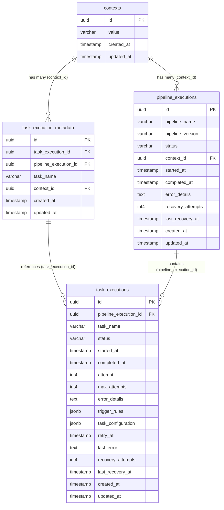
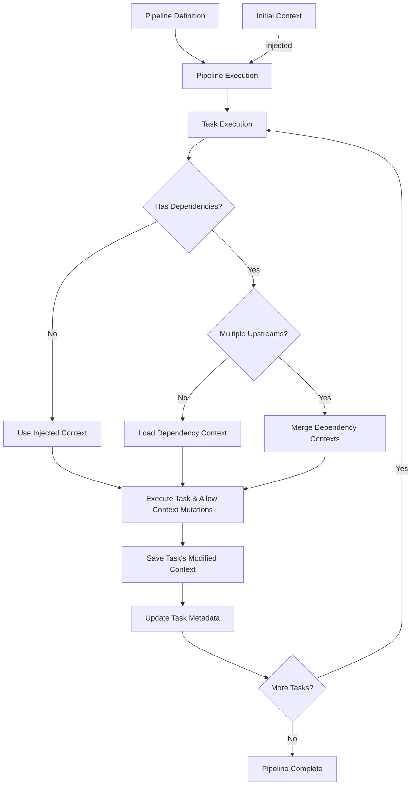

## Introduction

The Context system is a fundamental component of Cloacina that enables safe and efficient data sharing between tasks. This article explores how it works and how to use it effectively.

## Context Fundamentals

### What is the Context System?

The Context system provides:
- Type-safe data sharing between tasks
- Atomic updates with database persistence
- Automatic dependency resolution
- Thread-safe access patterns

### Core Components

The context system consists of several key components:

1. **Context Structure** [`cloacina::context::Context`](../../../reference/api/rust/cloacina-workflow/context/#struct.Context)
   - Generic type-safe container for task data
   - JSON serialization for persistence
   - Execution scope tracking
   - Dependency loading capabilities

2. **Database Integration** [`cloacina::models::context::DbContext`](../../../reference/api/rust/cloacina/models/context/#struct.DbContext)
   - Contexts are stored in the `contexts` table
   - Task execution metadata links contexts to tasks
   - Automatic timestamp management
   - UUID-based record identification

3. **Dependency Management** [`cloacina::executor::types::DependencyLoader`](../../../reference/api/rust/cloacina/executor/types/#struct.DependencyLoader)
   - Automatic loading of values from dependency tasks
   - Configurable dependency loading strategy
   - Caching of loaded values for performance

## System Architecture

### Database Schema



## Data Flow Patterns

### Context Flow



Data flows between tasks through two main mechanisms:

1. **Initial Context** [`cloacina::scheduler::Scheduler::load_context_for_task`](../../../reference/api/rust/cloacina/)
   - Initial context is injected when pipeline starts
   - Available to all tasks in the pipeline
   - Tasks can read and modify this data
   - Changes are persisted between task executions
   - Used as base when no dependencies exist

2. **Transitive Dependencies** [`cloacina::executor::types::DependencyLoader::load_from_dependencies`](../../../reference/api/rust/cloacina/executor/types/#DependencyLoader.load_from_dependencies)
   - Task contexts are automatically loaded for dependent tasks
   - Dependencies are transitive - can access data from dependencies' dependencies
   - Values are merged based on dependency order
   - Later dependencies override earlier ones
   - Implemented through the DependencyLoader's "latest wins" strategy

### Context Merge Algorithm

When multiple upstream tasks feed into a single task (a "reduce" in the topology), their contexts are merged using a "latest wins" strategy:

1. **Dependency Order**
   - The order of dependencies is determined by how they are declared in the task's `dependencies()` method
   - For example, if a task declares `dependencies() -> &[String] { &["task1", "task2", "task3"] }`, this defines the base order
   - The system processes dependencies in reverse order (from last to first) to implement "latest wins"

2. **Merge Process** [`cloacina::executor::types::DependencyLoader::load_from_dependencies`](../../../reference/api/rust/cloacina/executor/types/#DependencyLoader.load_from_dependencies)
   - Each upstream task's context is loaded from the database
   - Dependencies are processed in reverse order of declaration
   - For each key in the upstream contexts:
     - If only one upstream task sets the key: use that value
     - If multiple tasks set the key: use the value from the last dependency in the list


For example, if a task has dependencies `["task1", "task2", "task3"]`:
- The system will process them in reverse order: `task3`, then `task2`, then `task1`
- If all three tasks set a key "result", the value from `task3` will be used because it's processed last
- This is different from execution order (which is determined by the task graph topology) - it's purely based on the order in which dependencies are declared in the task's `dependencies()` method

### Concrete Example: Merging Two Task Dependencies

Let's walk through a simple example with two task dependencies to see how context merging works:

```rust
// Task1's context
{
    "user_id": 123,
    "status": "pending"
}

// Task2's context
{
    "status": "completed",
    "result": 42
}

// Final merged context (processing in reverse order: Task2, then Task1)
{
    "user_id": 123,    // From Task1 (only Task1 set this)
    "status": "completed",  // From Task2 (overrides Task1's value)
    "result": 42       // From Task2 (only Task2 set this)
}
```

:::caution[Warning]
**Context Key Management**

When designing tasks and workflows, be mindful of context key naming to avoid unintended overrides during merging. Since the merge process uses a "latest wins" strategy, tasks that set the same key will override each other's values based on dependency order.

Best practices:
- Use namespaced keys (e.g., `task_name.key`) to avoid collisions
- Document which keys your task reads and writes
- Consider the full dependency chain when choosing key names
- Be explicit about key ownership in task documentation

Example of good key naming:
```rust
// Instead of generic keys like:
{
    "status": "pending",
    "result": 42
}

// Use namespaced keys:
{
    "user_validation.status": "pending",
    "data_processing.result": 42
}
```
:::

:::note[Note]
**Why No Automatic Namespacing?**

While automatic key namespacing (e.g., prefixing all keys with task IDs or names) might seem like an obvious solution to collision prevention, we deliberately chose not to implement it. Here's why:

1. **Collision Resolution is Still Required**: Even with automatic namespacing, tasks would still need to coordinate on key names when they intentionally want to share data. The fundamental problem of coordination remains.

2. **Simple, Well-Defined Behavior**: By keeping the merge strategy simple ("latest wins" based on dependency order), we provide a clear, predictable behavior that developers can reason about and work with.

Rather than trying to solve this with technical means, we provide a simple, well-defined merge behavior and let developers handle coordination through good design and documentation.
:::


## Performance Considerations

### Context Size and Data Transfer

A context is stored as JSON text. One full copy is written for each completed task, each task gets the merge of its dependencies' contexts, and on an execution-agent fleet the whole context is sent to the agent in the work packet and comes back in the result. A large value in a context is carried by every later task of the run.

Contexts are for small metadata and control information. For large data:

1. Write the data to storage in the task: a file on a shared volume, an object store, a database table.
2. Put the reference in the context: a path, a URI, a row id.
3. Read the data from storage in the task that needs it.

```rust
// Do not put the data in the context:
{
    "image_data": "base64_encoded_10mb_image...",
    "document_content": "very_long_text..."
}

// Store the data and pass the reference:
{
    "image_uri": "s3://bucket/images/123.jpg",
    "document_id": "doc_456"
}
```

Cloacina has no artifact store. The task reads and writes the storage with its own client.

### Context Size Limits

The size of a context is the number of bytes of its JSON text. Two limits apply to it:

| Limit | Default | Server flag | Environment variable | `DefaultRunnerConfig` |
|---|---|---|---|---|
| Warning | 1 MiB (`1048576`) | `--context-warn-bytes` | `CLOACINA_CONTEXT_WARN_BYTES` | `context_warn_bytes` |
| Hard limit | 16 MiB (`16777216`) | `--context-max-bytes` | `CLOACINA_CONTEXT_MAX_BYTES` | `context_max_bytes` |

A value of `0` turns that limit off. On a server the two settings apply to every tenant.

The size is checked in two places:

- **The context a task returns**, where the result is written. This is the same code for a task run in process and a task run by a fleet agent; for a fleet task the check is on the server, after the agent reports.
- **The input context built for a task** from the contexts of its dependencies (or the first context of the run), before the task runs or is put in a work packet for an agent. Two contexts that are each under the limit can merge into one that is over it.

Over the warning limit and not over the hard limit, the server writes a warn log with the task, the size and the largest top-level keys, and counts it in `cloacina_context_size_warnings_total`. The task is not affected.

Over the hard limit, the task fails:

```text
Context too large: the result context of task 'public::etl::orders::load' is 20971632 bytes, over the limit of 16777216 bytes. Largest keys: rows (20971522 bytes), summary (64 bytes), run_date (12 bytes). Write large data to storage in the task and pass a reference in the context.
```

- The error names the size, the limit and up to five of the largest top-level keys with the size of each value.
- The task is not retried, whatever its retry policy says. The next attempt would build the same context.
- The context is not saved.
- The run fails as it does for any failed task.
- In `cloacina_tasks_total` the attempt has `status="failed"` and `reason="context_too_large"`.

Every measured size is recorded in the histogram `cloacina_context_size_bytes` (labels `kind` and `tenant`). The size of each saved result context is stored with the task and returned as `context_size_bytes` by `GET /v1/tenants/{tenant_id}/executions/{exec_id}/tasks`, which shows the task where a context grew.

## Conclusion

The Context system provides a simple but powerful way to share data between tasks. By understanding the merge behavior and keeping contexts focused on essential metadata, you can build reliable and efficient workflows. Remember: contexts are for coordination, not for data storage - keep them small and focused.
