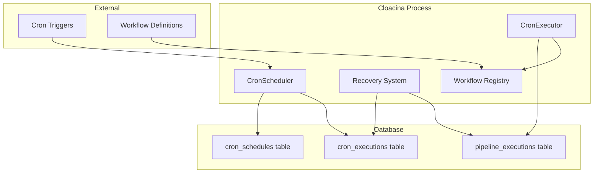
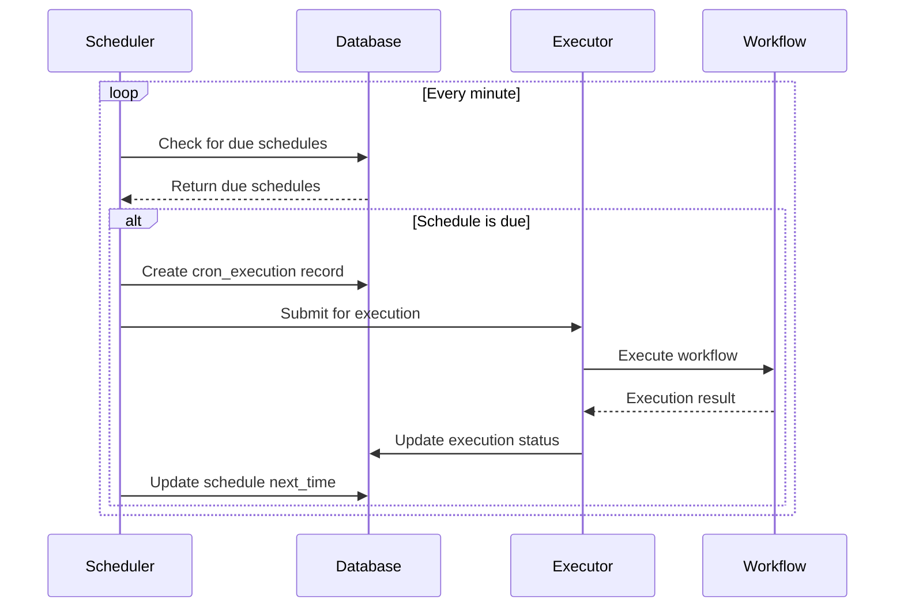

Cloacina provides a robust cron scheduling system with automatic recovery, distributed execution support, and strong consistency guarantees. It runs on both database backends — PostgreSQL for server deployments (where `FOR UPDATE SKIP LOCKED` claiming enables multi-replica scheduling) and SQLite for embedded and daemon deployments.

> **A note on the code excerpts below.** The `impl` blocks in this document are *illustrative pseudo-code* sketching the internal control flow — they are not the literal source. The user-facing API surface is `runner.register_cron_workflow(...)` and friends (see the [cron tutorial](../../../tutorials/embed/05-cron-scheduling/)); the real internals live in `crates/cloacina/src/cron_trigger_scheduler.rs`, `crates/cloacina/src/cron_recovery.rs`, and `crates/cloacina-workflow/src/cron_evaluator.rs`.

## Overview

The cron scheduling system consists of several key components:

- **CronScheduler** - Manages schedule parsing and next execution calculation
- **CronExecutor** - Handles actual workflow execution from schedules
- **Recovery System** - Automatically recovers from failures and missed executions
- **Database Integration** - Persistent storage with transaction safety

## Architecture Components



## Scheduling Process

### 1. Schedule Registration

```rust
// Register a cron schedule (the real user-facing API)
let schedule_id = runner
    .register_cron_workflow(
        "daily_backup",  // workflow name
        "0 2 * * *",     // cron expression — 2 AM daily
        "UTC",           // timezone
    )
    .await?;
```

**What happens internally:**

1. **Validation** - Cron expression is parsed and validated
2. **Storage** - Schedule is persisted to `cron_schedules` table
3. **Next Calculation** - Next execution time is calculated and stored
4. **Activation** - Schedule becomes active for execution

A workflow has one schedule per cron expression and timezone (a unique index holds this; named instances are apart). A second registration of the same workflow, expression and timezone returns the id of the schedule that exists and keeps its next and last run times; it updates the catch-up policy and the limit on active runs when the call declares them. The same holds for the schedule of a packaged trigger each time its package is loaded, on each server replica.

### 2. Schedule Evaluation

```rust
impl CronScheduler {
    async fn evaluate_schedules(&self) -> Result<Vec<DueExecution>, CronError> {
        let now = Utc::now();

        // Find all schedules due for execution
        let due_schedules = self.dal
            .find_due_schedules(now)
            .await?;

        let mut executions = Vec::new();
        for schedule in due_schedules {
            // Calculate next execution time
            let next_time = self.calculate_next_execution(&schedule)?;

            // Create execution record
            let execution = DueExecution {
                schedule_id: schedule.id,
                workflow_name: schedule.workflow_name,
                scheduled_time: now,
                next_time,
                context: schedule.context,
            };

            executions.push(execution);
        }

        Ok(executions)
    }
}
```

### 3. Execution Lifecycle



## Database Schema

### cron_schedules Table

```sql
CREATE TABLE cron_schedules (
    id UUID PRIMARY KEY DEFAULT gen_random_uuid(),
    workflow_name VARCHAR NOT NULL,
    cron_expression VARCHAR NOT NULL,
    timezone VARCHAR NOT NULL DEFAULT 'UTC',
    enabled BOOLEAN NOT NULL DEFAULT true,
    context JSONB NOT NULL DEFAULT '{}',
    next_execution_time TIMESTAMPTZ,
    created_at TIMESTAMPTZ NOT NULL DEFAULT CURRENT_TIMESTAMP,
    updated_at TIMESTAMPTZ NOT NULL DEFAULT CURRENT_TIMESTAMP
);
```

### cron_executions Table

```sql
CREATE TABLE cron_executions (
    id UUID PRIMARY KEY DEFAULT gen_random_uuid(),
    schedule_id UUID NOT NULL REFERENCES cron_schedules(id),
    scheduled_time TIMESTAMPTZ NOT NULL,
    actual_start_time TIMESTAMPTZ,
    completion_time TIMESTAMPTZ,
    status VARCHAR NOT NULL, -- 'scheduled', 'running', 'completed', 'failed'
    pipeline_execution_id UUID REFERENCES pipeline_executions(id),
    error_message TEXT,
    created_at TIMESTAMPTZ NOT NULL DEFAULT CURRENT_TIMESTAMP
);
```

## Execution Guarantees

### At-Least-Once Execution

Cloacina guarantees **at-least-once execution** for all scheduled workflows:

```rust
impl CronExecutor {
    async fn execute_schedule(&self, execution: CronExecution) -> Result<(), CronError> {
        // Mark as running
        self.dal.update_execution_status(
            &execution.id,
            CronExecutionStatus::Running,
            Some(Utc::now())
        ).await?;

        // Execute workflow
        let result = match self.workflow_executor.execute(
            &execution.workflow_name,
            execution.context
        ).await {
            Ok(result) => {
                // Mark as completed
                self.dal.update_execution_status(
                    &execution.id,
                    CronExecutionStatus::Completed,
                    Some(Utc::now())
                ).await?;
                result
            },
            Err(error) => {
                // Mark as failed with error details
                self.dal.update_execution_failed(
                    &execution.id,
                    &error.to_string(),
                    Some(Utc::now())
                ).await?;
                return Err(error.into());
            }
        };

        Ok(())
    }
}
```

### Exactly-Once Semantics

While execution is at-least-once, Cloacina provides mechanisms for exactly-once semantics:

```python
@cloaca.task()
def idempotent_backup(context):
    """Example of idempotent task design."""

    backup_date = context.get("backup_date")
    backup_id = f"backup_{backup_date}"

    # Check if backup already exists
    if backup_exists(backup_id):
        print(f"Backup {backup_id} already exists, skipping")
        context.set("backup_status", "already_exists")
        return context

    # Perform backup
    result = perform_backup(backup_id)
    context.set("backup_status", "created")
    context.set("backup_location", result.location)

    return context
```

## Recovery Mechanisms

### Automatic Recovery

The recovery system automatically handles various failure scenarios:

```rust
impl CronRecovery {
    async fn recover_orphaned_executions(&self) -> Result<u32, CronError> {
        let recovery_threshold = Utc::now() - Duration::minutes(30);

        // Find executions that started but never completed
        let orphaned = self.dal
            .find_orphaned_executions(recovery_threshold)
            .await?;

        let mut recovered_count = 0;
        for execution in orphaned {
            match self.attempt_recovery(&execution).await {
                Ok(_) => {
                    recovered_count += 1;
                    info!("Recovered orphaned execution: {}", execution.id);
                },
                Err(e) => {
                    error!("Failed to recover execution {}: {}", execution.id, e);
                }
            }
        }

        Ok(recovered_count)
    }

    async fn attempt_recovery(&self, execution: &CronExecution) -> Result<(), CronError> {
        // Check if the associated pipeline execution exists and its status
        if let Some(pipeline_id) = &execution.pipeline_execution_id {
            let pipeline_status = self.dal
                .get_pipeline_execution_status(pipeline_id)
                .await?;

            match pipeline_status {
                WorkflowStatus::Failed => {
                    // Mark cron execution as failed
                    self.dal.update_execution_status(
                        &execution.id,
                        CronExecutionStatus::Failed,
                        Some(Utc::now())
                    ).await?;
                },
                WorkflowStatus::Completed => {
                    // Mark cron execution as completed
                    self.dal.update_execution_status(
                        &execution.id,
                        CronExecutionStatus::Completed,
                        Some(Utc::now())
                    ).await?;
                },
                _ => {
                    // Re-submit for execution
                    self.resubmit_execution(execution).await?;
                }
            }
        } else {
            // No pipeline execution found, re-submit
            self.resubmit_execution(execution).await?;
        }

        Ok(())
    }
}
```

### Missed Execution Handling

When a scheduler starts after downtime and finds firings whose `next_execution_at` has already passed, the per-schedule `catchup_policy` column on `cron_schedules` decides what happens. Two values are defined in `crates/cloacina/src/models/schedule.rs`:

| `CatchupPolicy` | Behavior |
|---|---|
| `Skip` | Roll `next_execution_at` forward to the next future firing; the missed firings are dropped. Default for newly-registered schedules — appropriate when a missed firing has no value (e.g., dashboard refresh, hourly aggregation whose inputs have already advanced). |
| `RunAll` | Run every missed firing, oldest first, one at a time. Appropriate when each firing is independently durable work (e.g., per-hour table builds that must each run). |

#### After a restart, with packaged workflows

The schedule row of a packaged workflow stays in the database while the server is down. After the restart the cron scheduler and the reconciler start together, and the reconciler needs some time to load each package.

- The scheduler takes a firing only for a workflow that its runner has loaded. A schedule whose workflow is not loaded yet stays due. The scheduler looks at it again each second and when the reconciler registers a schedule, and takes the firing once the workflow is loaded.
- When a package is loaded, its schedule is registered again. A schedule row that already exists for the same workflow, cron expression and timezone keeps its `next_run_at` and `last_run_at`. The registration updates `enabled`, and the catch-up policy and the limit on active runs when the trigger declares them.

So the firings missed during the restart follow the catch-up policy: one run for `Skip`, with the fire time that was due, and each missed run for `RunAll`. This holds for the `public` tenant and for each tenant's runner.

A schedule row whose workflow is never loaded stays due, and `cloacina_schedule_lag_seconds` grows for it. Unloading a package removes its schedule rows.

#### How `RunAll` works through a backlog

No missed firing is dropped, however long the backlog is:

- One claim takes at most `cron_max_catchup_executions` firings (default 100). That number is a batch size, not a cap.
- The claim moves `last_run_at` to the last firing it took and `next_run_at` to the firing after it. While that is in the past the schedule stays due, and the next pass of the scheduler goes on from there.
- A `RunAll` schedule has one active run at a time, or as many as its `max_active_runs` (see [a limit on active runs](#a-limit-on-active-runs)). The scheduler does not wait for the run: when the schedule is at its limit it takes no firing and leaves the schedule due. When the run ends, the next firing is taken at once in the same process; another scheduler replica sees it within a second.
- A run is active while its `schedule_executions` row is open and its workflow execution has not reached `Completed`, `Failed` or `Cancelled`. A failed run does not stop the backlog: the next firing runs.
- The start of the backlog is `last_run_at`, or the creation time of a schedule that never ran. `RunAll` does not reach before the schedule was created.
- Each catch-up run gets the interval of the firing it stands for (see [the interval of a run](#the-interval-of-a-run)).

Two things to know while a backlog drains:

- The schedule stays due, so `cloacina_schedule_lag_seconds` shows the age of the oldest firing not yet taken. It falls as the backlog drains. An alert on that gauge fires during a long catch-up.
- With more than one scheduler replica, the claim is a transaction on the schedule row: it checks that the row is as the scheduler read it, counts the active runs, writes the `schedule_executions` rows and moves the schedule. Two replicas cannot take the same firing, and cannot both start a run past the limit.

A handoff that is lost (the process stops between the claim and the start of the run) holds the slot of the schedule until the cron recovery service fires it again. Recovery measures the age of a lost handoff from the time of the claim, so a catch-up firing for an old interval is recovered like any other. A handoff that recovery gives up on (older than `cron_max_recovery_age` since the claim, or `cron_max_recovery_attempts` spent) is marked complete, so it frees the slot. With `cron_enable_recovery` off, nothing does this: a lost handoff then holds a `RunAll` schedule until its row is completed by hand.

The scheduler applies the policy when it claims a due schedule. The policy is declared with the schedule, and the default is `skip`:

| Where the schedule is declared | How to set the policy |
|---|---|
| Rust packaged trigger | `#[trigger(on = "wf", cron = "0 * * * *", catchup = "run_all")]` |
| Python packaged trigger | `@cloaca.trigger(on="wf", cron="0 * * * *", catchup="run_all")` |
| Named instance (HTTP) | `"catchup_policy": "run_all"` in the body of `POST /v1/tenants/{tenant}/workflows/{name}/instances` |
| Named instance (CLI) | `cloacinactl instance create wf name --cron "0 * * * *" --catchup run_all` |
| Embedded Rust | `runner.register_cron_workflow_with_options(wf, expr, tz, &CronScheduleOptions { catchup_policy: Some(CatchupPolicy::RunAll), max_active_runs: None })` |
| Embedded Python | `runner.register_cron_workflow(wf, expr, tz, catchup_policy="run_all")` |

A value that is not `skip` or `run_all` is an error at each of these places. A packaged trigger that declares no policy does not change the policy of a schedule that already exists, so a policy set on the row by an operator survives a re-load of the package.

### A limit on active runs

A cron schedule can declare `max_active_runs`: the most runs of that schedule that may be active at once. When the schedule is due and has that many active runs, the scheduler starts no new run and leaves the schedule due. It looks again when a run of the schedule ends, and each second.

| Policy | `max_active_runs` not declared | `max_active_runs = N` |
|---|---|---|
| `skip` | No limit. A fire starts a run even while the run before it is active. | A fire that comes due at the limit waits. When a run ends the schedule fires once, for the due time it was held at, and the fire times missed in between are skipped. Runs of the schedule do not overlap with `N = 1`. |
| `run_all` | One active run: the missed fire times run one after another, oldest first. | Up to `N` active runs: the backlog drains `N` at a time. Runs start oldest first; with `N` above 1 they can end in any order. |

It is declared next to the catch-up policy:

| Where the schedule is declared | How to set the limit |
|---|---|
| Rust packaged trigger | `#[trigger(on = "wf", cron = "0 * * * *", catchup = "run_all", max_active_runs = 4)]` |
| Python packaged trigger | `@cloaca.trigger(on="wf", cron="0 * * * *", catchup="run_all", max_active_runs=4)` |
| Named instance (HTTP) | `"max_active_runs": 4` in the body of `POST /v1/tenants/{tenant}/workflows/{name}/instances` |
| Named instance (CLI) | `cloacinactl instance create wf name --cron "0 * * * *" --catchup run_all --max-active-runs 4` |
| Embedded Rust | `CronScheduleOptions { catchup_policy: Some(CatchupPolicy::RunAll), max_active_runs: Some(4) }` |
| Embedded Python | `runner.register_cron_workflow(wf, expr, tz, catchup_policy="run_all", max_active_runs=4)` |

The value is 1 or more; `0` is an error. It is stored in `schedules.max_active_runs` (NULL when not declared). A packaged trigger that declares no limit does not change the limit of a schedule that already exists.

The limit counts the runs that this schedule started. It does not count a manual run of the same workflow, a run started by another schedule or trigger of the workflow, or the runs of another named instance: each schedule row has its own count. It limits workflow runs, not tasks: `max_concurrent_tasks` still bounds how many tasks run at once.

A long backlog is cheap to hold: 5,500 missed hourly fire times are two timestamps on the schedule row, and the scheduler starts `N` runs at a time, not 5,500 at once.

`run_all` starts at the creation of the schedule, so it does not load the history from before that. A [backfill](#backfill) loads a chosen range of intervals.

See [Configuration Reference](../../../reference/configuration/) for the related knobs:
`cron_max_catchup_executions` (default 100), `cron_recovery_interval` (default 5min), `cron_max_recovery_age` (default 24h), `cron_max_recovery_attempts` (default 3).

## The interval of a run

Each cron run gets the interval that it covers in its context, next to the other scheduler keys:

| Key | Value |
|---|---|
| `scheduled_time` | The fire time of this run. |
| `interval_start` | The fire time of the expression before `scheduled_time`. |
| `interval_end` | Equal to `scheduled_time`. |
| `schedule_id`, `schedule_timezone`, `schedule_expression` | The schedule that fired. |

The times are RFC 3339 strings in UTC. An hourly job that fires at `2026-01-01T05:00:00+00:00` gets `interval_start = 2026-01-01T04:00:00+00:00` and `interval_end = 2026-01-01T05:00:00+00:00`. A task that builds a table from landed files reads the two keys and takes the files of that hour.

The interval follows the cron expression in the timezone of the schedule, so it is not always the same length. A daily job in `America/New_York` has one 23 hour interval and one 25 hour interval each year. The start of one interval is always the end of the interval before it.

A catch-up run (`run_all`) and a run that the recovery service fires again get the interval of the fire time they stand for, not of the time they start.

### The same keys on a manual run

`interval_start` and `interval_end` are not reserved. A manual run sets them in its context like any other key:

```bash
curl -X POST "$SERVER/v1/tenants/acme/workflows/build_hourly_table/execute" \
  -H "Authorization: Bearer $KEY" -H "Content-Type: application/json" \
  -d '{"context": {"interval_start": "2026-01-01T04:00:00+00:00", "interval_end": "2026-01-01T05:00:00+00:00"}}'
```

So a workflow reads its interval from the same keys in a scheduled run, a manual run and a backfill.

The server checks the two keys on a manual run. A run that sets one must set both. Each is an RFC 3339 timestamp in a string, and `interval_end` is after `interval_start`. A run that breaks one of these rules gets `400` with the code `invalid_interval` and a message that names the key. A run with neither key is not checked.

The other scheduler keys (`scheduled_time`, `schedule_id`, `schedule_timezone`, `schedule_expression`, `trigger_name`, `triggered_at`) stay reserved: a manual run that sends them has them dropped, with no error. On a cron run the scheduler writes all of its keys after the bound params of an instance, so a param named `interval_start` does not change the interval of a scheduled run.


## Backfill

A backfill is a bounded second schedule for one workflow. It runs the workflow once for each fire time of a cron expression from a start to an end, oldest first, and then turns itself off. It loads the history that `run_all` does not reach, and it runs a range again.

```bash
cloacinactl backfill create build_hourly_table \
  --cron "0 * * * *" --start 2026-01-01T00:00:00Z --end 2026-08-18T23:00:00Z \
  --max-active-runs 8
```

### The range

The backfill takes each fire time `F` of the expression with `start <= F <= end`. Each fire time is one interval, with the same meaning as on a cron run: `interval_end = F` and `interval_start` is the fire time before `F`. A backfill of one interval has `start = end = F`. One backfill holds at most 100,000 intervals.

Each run gets the keys of a cron run (`scheduled_time`, `interval_start`, `interval_end`, `schedule_id`, `schedule_timezone`, `schedule_expression`) and `backfill_id`, the id of the backfill. The params of the backfill are merged first, so the scheduler's keys win.

### How it is stored

A backfill is a row of `schedules`:

| Column | Value |
|---|---|
| `schedule_type` | `backfill` |
| `catchup_policy` | `run_all` |
| `max_active_runs` | The limit of the backfill. 1 when not given. |
| `last_run_at` | At creation: the fire time before the range. After that: the last fire time taken. This is the position of the backfill. |
| `next_run_at` | The next fire time to take. |
| `backfill` | JSON: `start`, `end`, `first_fire`, `last_fire`, `total`, and for a retry `fire_times` and `retry_of`. |
| `start_date`, `end_date` | Empty. The scheduler compares these two with the wall clock; a backfill is bounded by fire time, by `last_fire`. |

So a range of 5,500 intervals is one row, and its progress is one timestamp. The schedule execution rows of the backfill are the record of the intervals that got a run.

The type keeps the row apart from the live schedules. The registration of a packaged cron trigger matches rows of type `cron` only, so it never changes a backfill. The schedule list (`GET /v1/tenants/{tenant}/triggers`) leaves backfills out. The gauge `cloacina_schedule_lag_seconds` reads cron schedules only.

### How it runs

The cron loop of the scheduler looks at the due backfills on each pass. For one backfill it computes the next fire times of the range, at most `cron_max_catchup_executions` of them and none after the present, and takes them with the same claim as a `run_all` schedule: as many as `max_active_runs` leaves room for, each with a schedule execution row, in one transaction. A backfill at its limit stays due; the loop looks again when one of its runs ends, and each second.

- **Order.** Intervals start oldest first. With a limit above 1, runs can end in any order.
- **Its own limit.** The limit counts the runs of the backfill only. The live schedule of the workflow keeps its own limit, and the two do not wait for each other.
- **Overlap.** A backfill can cover fire times that the live schedule ran or will run. Nothing checks for it: the workflow must be safe to run twice for one interval.
- **A failed run.** The backfill goes on with the next interval. An interval is failed when its run ended `Failed` or `Cancelled`, or when no run could be started for it.
- **The end.** When no fire time of the range is left and no run of the backfill is active, the scheduler disables the row.
- **Cancel.** Cancel disables the row. No new interval gets a run; active runs end on their own.

### Progress

`GET /v1/tenants/{tenant}/workflows/{name}/backfills/{id}` and `cloacinactl backfill inspect` give `total`, `completed`, `failed`, `running`, `remaining`, the position (`last_interval_end`, `next_interval_end`), the status and the failed intervals. `remaining` and the status are read from the position of the row. `completed`, `failed` and `running` are counted from the schedule execution rows and their workflow executions.

### Retry

`POST …/backfills/{id}/retry` and `cloacinactl backfill retry` create a new backfill from the failed intervals of an earlier one. The new row holds the list of fire times in `backfill.fire_times` and the id of the earlier backfill in `backfill.retry_of`. It runs those fire times only, oldest first, with the same expression, timezone and params.

See [Load History with a Backfill](../../../how-to/service/load-history-with-a-backfill/) for the steps.

## Cron Expression Parsing

### Supported Format

Cloacina parses expressions with the [`croner`](https://crates.io/crates/croner) crate, configured with **optional seconds** (`CronEvaluator`, `crates/cloacina-workflow/src/cron_evaluator.rs`). Both the standard 5-field form and a 6-field form with a leading seconds field are accepted, with timezone support:

```
              ┌───────────── minute (0 - 59)
              │ ┌───────────── hour (0 - 23)
              │ │ ┌───────────── day of month (1 - 31)
              │ │ │ ┌───────────── month (1 - 12)
              │ │ │ │ ┌───────────── day of week (0 - 6) (Sunday to Saturday)
              │ │ │ │ │
              * * * * *      # 5-field (standard)

┌───────────── second (0 - 59, optional)
│             │
*             * * * * *      # 6-field (leading seconds), e.g. "*/3 * * * * *"
```

### Expression Examples

```rust
// Valid cron expressions
let expressions = vec![
    "0 2 * * *",        // Daily at 2 AM
    "*/15 * * * *",     // Every 15 minutes
    "0 9 * * MON-FRI",  // Weekdays at 9 AM
    "0 0 1 * *",        // First day of each month
    "0 */6 * * *",      // Every 6 hours
    "30 2 * * SUN",     // Sundays at 2:30 AM
];

// Expression validation
impl CronScheduler {
    fn validate_expression(&self, expr: &str) -> Result<Schedule, CronError> {
        Schedule::from_str(expr)
            .map_err(|e| CronError::InvalidExpression(e.to_string()))
    }

    fn calculate_next_execution(
        &self,
        schedule: &CronSchedule
    ) -> Result<DateTime<Utc>, CronError> {
        let cron_schedule = self.validate_expression(&schedule.cron_expression)?;
        let timezone = schedule.timezone.parse::<Tz>()
            .map_err(|e| CronError::InvalidTimezone(e.to_string()))?;

        let now = Utc::now().with_timezone(&timezone);
        let next = cron_schedule.upcoming(timezone)
            .next()
            .ok_or(CronError::NoFutureExecution)?;

        Ok(next.with_timezone(&Utc))
    }
}
```

## Timezone Handling

### Timezone Support

```rust
impl CronSchedule {
    pub fn new_with_timezone(
        workflow_name: String,
        cron_expression: String,
        timezone: &str,
    ) -> Result<Self, CronError> {
        // Validate timezone
        let tz = timezone.parse::<Tz>()
            .map_err(|_| CronError::InvalidTimezone(timezone.to_string()))?;

        Ok(CronSchedule {
            workflow_name,
            cron_expression,
            timezone: timezone.to_string(),
            enabled: true,
            context: Context::new(),
            // ... other fields
        })
    }
}
```

### Daylight Saving Time

```rust
// DST transition handling
fn calculate_next_with_dst_awareness(
    expr: &str,
    timezone: &Tz,
    from: DateTime<Utc>
) -> Result<DateTime<Utc>, CronError> {
    let schedule = Schedule::from_str(expr)?;
    let local_time = from.with_timezone(timezone);

    // Handle DST transitions
    match schedule.upcoming(timezone).next() {
        Some(next) => {
            // Verify the next execution isn't in a DST gap
            if is_dst_gap(&next, timezone) {
                // Skip forward to avoid the gap
                let adjusted = next + Duration::hours(1);
                Ok(adjusted.with_timezone(&Utc))
            } else {
                Ok(next.with_timezone(&Utc))
            }
        },
        None => Err(CronError::NoFutureExecution)
    }
}
```

## Distributed Execution

Multiple `cloacina-server` instances can run against the same database with no coordinator and no leader election. The mechanism is the same database-as-coordination pattern used elsewhere in Cloacina: each scheduler tick attempts an **atomic `claim_and_update` UPDATE** on `cron_schedules` rows whose `next_execution_at` has passed. Postgres `FOR UPDATE SKIP LOCKED` (and SQLite's transactional equivalent) ensures exactly one scheduler wins the row per firing — the winner advances `next_execution_at` and dispatches the workflow; losers move on without contention.

Because there's no lease and no leader, **failover is trivial**: if a scheduler crashes mid-firing, the row's `last_claim_at` ages past `stale_claim_threshold` and the next scheduler tick reclaims it. The two-phase commit pattern (see [Guaranteed Execution Architecture](../guaranteed-execution-architecture/)) ensures the dispatch is idempotent — a re-claim re-issues the firing without duplicating downstream work.

Scaling shape: add or remove `cloacina-server` replicas at will. Each replica polls independently; the atomic claim is the only coordination primitive. There is no membership protocol, no quorum, no broker.

See `crates/cloacina/src/cron_trigger_scheduler.rs` for the claim implementation and [Horizontal Scaling](../../service/horizontal-scaling/) for the analogous task-level mechanism.


## Performance Considerations

### Efficient Polling

```rust
impl CronScheduler {
    async fn optimized_schedule_check(&self) -> Result<(), CronError> {
        // Use database-level filtering to minimize data transfer
        let current_time = Utc::now();
        let check_window = current_time + Duration::minutes(2);

        // Only fetch schedules due within the next 2 minutes
        let due_schedules = self.dal
            .find_schedules_due_within(current_time, check_window)
            .await?;

        // Process in batches to avoid overwhelming the system
        for batch in due_schedules.chunks(10) {
            self.process_schedule_batch(batch).await?;
        }

        Ok(())
    }
}
```

### Index Optimization

```sql
-- Optimized indexes for cron scheduling
CREATE INDEX CONCURRENTLY idx_cron_schedules_next_execution
ON cron_schedules(next_execution_time)
WHERE enabled = true;

CREATE INDEX CONCURRENTLY idx_cron_executions_status_scheduled
ON cron_executions(scheduled_time, status);

CREATE INDEX CONCURRENTLY idx_cron_executions_orphaned
ON cron_executions(actual_start_time)
WHERE status = 'running' AND completion_time IS NULL;
```

## Monitoring and Observability

Cron observability rides the same `cloacina_*` Prometheus metric namespace as the rest of the system (CLOACI-I-0099). There is no separate `CronMetrics` struct; cron firings are workflow executions, so the workflow-level counters cover them naturally.

Operationally relevant metrics for cron:

- **`cloacina_workflows_total{status, reason}`** — workflow executions, including those triggered by cron. Compare cron-driven volume to expected cadence to detect missed firings.
- **`cloacina_active_workflows{tenant}`** — SQL-derived gauge (CLOACI-I-0108) showing workflows in `Pending` or `Running` state right now. A persistently-high value alongside high cron cadence indicates the executor is falling behind.
- **`cloacina_scheduler_claim_attempts_total{outcome=claimed|contended|empty}`** — diagnostic for multi-scheduler deployments. Sustained `contended` ≫ 0 means multiple schedulers are racing for the same rows (expected at low scale; tune `cron_poll_interval` down if it becomes load).
- **`cloacina_scheduler_stale_claims_swept_total`** — non-zero rate indicates a scheduler crashed mid-firing and the sweep reclaimed its row. Investigate scheduler logs for the affected window.

For the full namespace + PromQL recipes, see [Metrics Catalog](../../../reference/metrics-catalog/). For the rationale behind the SQL-derived gauge model (why `cloacina_active_workflows` is leak-proof across crashes), see [Observability](../../service/observability/).


## Best Practices

### Schedule Design

```python
# Good: Idempotent with clear failure handling
@cloaca.task()
def robust_backup(context):
    backup_id = context.get("backup_id")

    try:
        # Check if already done
        if backup_exists(backup_id):
            return context

        # Perform backup
        result = create_backup(backup_id)
        context.set("backup_success", True)
        context.set("backup_location", result.path)

    except Exception as e:
        context.set("backup_success", False)
        context.set("error", str(e))
        # Don't re-raise - let cron handle retry policy

    return context

# Avoid: Non-idempotent operations
@cloaca.task()
def bad_counter(context):
    # This will cause issues if executed multiple times
    current = get_counter()
    set_counter(current + 1)  # Race condition!
    return context
```

### Error Handling

```rust
impl CronExecutor {
    async fn execute_with_retry(
        &self,
        execution: &CronExecution,
        max_retries: u32
    ) -> Result<(), CronError> {
        let mut attempt = 0;

        while attempt < max_retries {
            match self.execute_once(execution).await {
                Ok(_) => return Ok(()),
                Err(e) if attempt == max_retries - 1 => {
                    // Final attempt failed
                    error!("Cron execution failed after {} attempts: {}", max_retries, e);
                    return Err(e);
                },
                Err(e) => {
                    attempt += 1;
                    warn!("Cron execution attempt {} failed: {}", attempt, e);

                    // Exponential backoff
                    let delay = Duration::seconds(2_i64.pow(attempt));
                    tokio::time::sleep(delay.to_std().unwrap()).await;
                }
            }
        }

        unreachable!()
    }
}
```

## See Also

- [Cron Scheduling Tutorial](../../../tutorials/embed/05-cron-scheduling/) - Practical implementation guide
- [Python Cron Tutorial](../../../tutorials/embed/05-cron-scheduling/) - Python-specific examples
- [Multi-Tenant Setup Guide](../../../how-to/service/multi-tenant-setup/) - Deployment best practices
- [Guaranteed Execution Architecture](../guaranteed-execution-architecture/) - Overall execution guarantees
