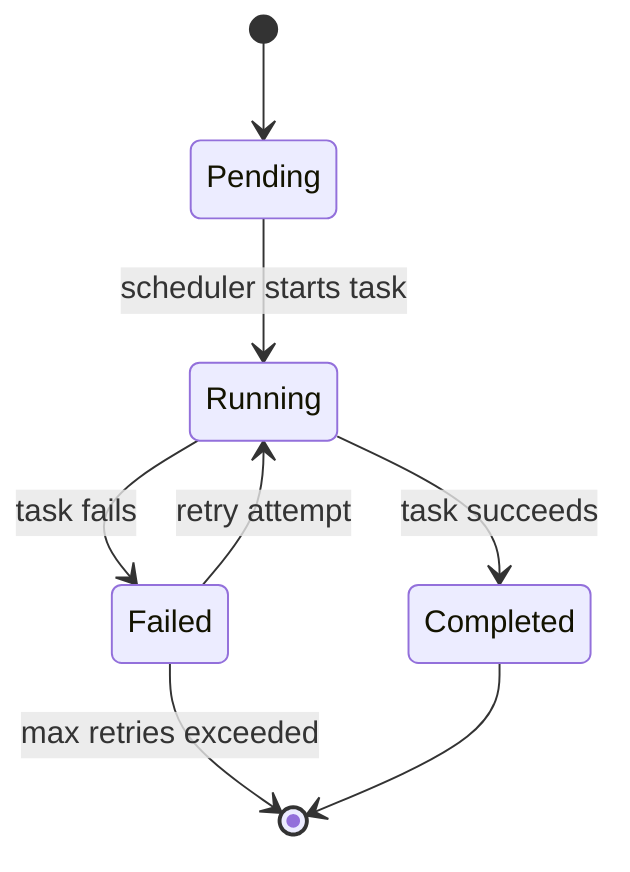

<span class="plissken-badge plissken-badge-source" style="display: inline-block; padding: 0.05em 0.6em; font-family: var(--sl-font-mono); font-size: var(--sl-text-xs); line-height: 1.6; border-radius: var(--radius-pill, 1rem); vertical-align: middle; background: var(--sl-color-orange-low); color: var(--sl-color-orange-high);">Rust</span>

**Task Management**

This module provides the core task execution framework. Tasks are the fundamental building
blocks of Cloacina workflows - they represent individual units of work that can be executed
with dependencies, retry policies, and persistent state management.

**Core Concepts**

- **Tasks**: Individual units of work that can be executed asynchronously
- **Context**: Shared state container for passing data between tasks
- **Dependencies**: Directed acyclic graph (DAG) of task relationships
- **State Management**: Tracking task execution progress and status
- **Retry Policies**: Configurable error handling and retry strategies
- **Trigger Rules**: Conditional execution based on context data

**Task Lifecycle**

Tasks progress through these states during execution:



**State Management**

Each task maintains its execution state for monitoring and recovery:

- **Pending**: Task is registered but not yet started
- **Running**: Task is currently executing
- **Completed**: Task finished successfully
- **Failed**: Task encountered an error

**Error Handling**

Tasks can handle errors in several ways:

- **Transient Failures**: Temporary issues that may succeed on retry
- **Permanent Failures**: Issues that won't succeed on retry
- **Retry Policies**: Configurable retry strategies with backoff

**Context Management**

The Context provides a thread-safe way to share data between tasks:

- **Type Safety**: Generic type parameter ensures data consistency
- **Serialization**: Automatic serialization for persistence
- **Thread Safety**: Safe concurrent access to shared data

**Tutorial: Your First Task**

The easiest way to create tasks is with the `#[task]` macro:

```rust
use cloacina::*;

#[task(
    id = "hello_world",
    dependencies = []
)]
async fn hello_world(context: &mut Context<serde_json::Value>) -> Result<(), TaskError> {
    println!("Hello from Cloacina!");
    context.insert("greeting", serde_json::json!("Hello World!"))?;
    Ok(())
}
```

That's it! The macro automatically:
- Implements the [`Task`](../../../rust/cloacina/registry/loader/constructor_loader/#enum.ConstructorBinding) trait
- Registers the task globally for use in workflows
- Generates a unique code fingerprint for versioning
- Handles context serialization

**Tutorial: Tasks with Dependencies**

Tasks can depend on other tasks, forming a directed acyclic graph (DAG):

```rust
use cloacina::*;

#[task(id = "fetch_data", dependencies = [])]
async fn fetch_data(ctx: &mut Context<serde_json::Value>) -> Result<(), TaskError> {
    // Simulate fetching data
    ctx.insert("raw_data", serde_json::json!({"users": [1, 2, 3]}))?;
    println!("Data fetched");
    Ok(())
}

#[task(id = "process_data", dependencies = ["fetch_data"])]
async fn process_data(ctx: &mut Context<serde_json::Value>) -> Result<(), TaskError> {
    // This task runs after fetch_data completes
    if let Some(raw_data) = ctx.get("raw_data") {
        ctx.insert("processed_data", serde_json::json!({"processed": raw_data}))?;
        println!("Data processed");
    }
    Ok(())
}

#[task(id = "save_data", dependencies = ["process_data"])]
async fn save_data(ctx: &mut Context<serde_json::Value>) -> Result<(), TaskError> {
    if let Some(processed_data) = ctx.get("processed_data") {
        println!("Saving: {:?}", processed_data);
    }
    Ok(())
}

// Execution order: fetch_data → process_data → save_data
```

**Task Lifecycle**

Tasks progress through these states during execution:


**How-To Guide: Error Handling and Retries**

Configure retry policies for resilient task execution:

```rust
use cloacina::*;
use std::time::Duration;

#[task(
    id = "network_request",
    dependencies = [],
    retry_policy = RetryPolicy::builder()
        .max_attempts(3)
        .initial_delay(Duration::from_secs(1))
        .backoff_strategy(BackoffStrategy::Exponential { base: 2.0, multiplier: 1.0 })
        .retry_condition(RetryCondition::TransientOnly)
        .build()
)]
async fn network_request(ctx: &mut Context<serde_json::Value>) -> Result<(), TaskError> {
    // This will retry up to 3 times with exponential backoff
    // if it fails with a transient error
    match make_api_call().await {
        Ok(data) => {
            ctx.insert("api_response", data)?;
            Ok(())
        }
        Err(e) if is_transient_error(&e) => {
            Err(TaskError::TransientFailure(e.to_string()))
        }
        Err(e) => {
            Err(TaskError::PermanentFailure(e.to_string()))
        }
    }
}

```

**How-To Guide: Conditional Execution**

Use trigger rules for conditional task execution based on context data:

```rust
use cloacina::*;

#[task(id = "validate_input", dependencies = [])]
async fn validate_input(ctx: &mut Context<serde_json::Value>) -> Result<(), TaskError> {
    // Simulate validation
    let is_valid = true; // Your validation logic here
    ctx.insert("validation_passed", serde_json::json!(is_valid))?;
    Ok(())
}

#[task(
    id = "process_if_valid",
    dependencies = ["validate_input"],
    trigger_rules = serde_json::json!({
        "type": "Conditional",
        "condition": {
            "field": "validation_passed",
            "operator": "Equals",
            "value": true
        }
    })
)]
async fn process_if_valid(ctx: &mut Context<serde_json::Value>) -> Result<(), TaskError> {
    // This only runs if validation_passed == true in the context
    println!("Processing valid data");
    Ok(())
}
```

**How-To Guide: Working with Context Data**

The [`Context`](../../../rust/cloacina-workflow/context/#struct.Context) is your primary way to share data between tasks:

```rust
use cloacina::*;
use serde_json::json;

#[task(id = "producer", dependencies = [])]
async fn producer_task(ctx: &mut Context<serde_json::Value>) -> Result<(), TaskError> {
    // Insert various types of data
    ctx.insert("user_id", json!(12345))?;
    ctx.insert("config", json!({"env": "production", "batch_size": 100}))?;
    ctx.insert("timestamp", json!(chrono::Utc::now()))?;
    Ok(())
}

#[task(id = "consumer", dependencies = ["producer"])]
async fn consumer_task(ctx: &mut Context<serde_json::Value>) -> Result<(), TaskError> {
    // Read data from context
    let user_id: i64 = ctx.get("user_id")
        .and_then(|v| v.as_i64())
        .ok_or_else(|| TaskError::DataError("Missing user_id".to_string()))?;

    let config = ctx.get("config")
        .ok_or_else(|| TaskError::DataError("Missing config".to_string()))?;

    let batch_size = config.get("batch_size")
        .and_then(|v| v.as_i64())
        .unwrap_or(50);

    // Use the data
    println!("Processing user {} with batch size {}", user_id, batch_size);

    // Update context with results
    ctx.insert("processed_count", json!(batch_size))?;
    Ok(())
}
```

**How-To Guide: Task Testing**

Test your tasks in isolation:

```rust
use cloacina::*;

#[task(id = "math_task", dependencies = [])]
async fn math_task(ctx: &mut Context<serde_json::Value>) -> Result<(), TaskError> {
    let a = ctx.get("a").and_then(|v| v.as_i64()).unwrap_or(0);
    let b = ctx.get("b").and_then(|v| v.as_i64()).unwrap_or(0);
    ctx.insert("result", serde_json::json!(a + b))?;
    Ok(())
}

#[cfg(test)]
mod tests {
    use super::*;

    #[tokio::test]
    async fn test_math_task() {
        let mut ctx = Context::new();
        ctx.insert("a", serde_json::json!(5)).unwrap();
        ctx.insert("b", serde_json::json!(3)).unwrap();

        // Test the task function directly
        math_task(&mut ctx).await.unwrap();

        let result = ctx.get("result").unwrap();
        assert_eq!(result, &serde_json::json!(8));
    }
}
```

**Advanced: Manual Task Implementation**

For advanced use cases, you can implement the [`Task`](../../../rust/cloacina/registry/loader/constructor_loader/#enum.ConstructorBinding) trait manually instead of using the macro:

```rust
use cloacina::*;
use async_trait::async_trait;

struct CustomTask {
    id: String,
    dependencies: Vec<String>,
}

#[async_trait]
impl Task for CustomTask {
    async fn execute(&self, mut context: Context<serde_json::Value>) -> Result<Context<serde_json::Value>, TaskError> {
        // Your custom logic here
        context.insert("custom_processed", serde_json::json!(true))?;
        Ok(context)
    }

    fn id(&self) -> &str {
        &self.id
    }

    fn dependencies(&self) -> &[String] {
        &self.dependencies
    }

    fn retry_policy(&self) -> crate::retry::RetryPolicy {
        // Custom retry policy
        crate::retry::RetryPolicy::builder()
            .max_attempts(5)
            .build()
    }
}
```

**Task State Management**

Tasks track their execution state for monitoring and recovery:

## Re-exports

- [`Task`](../../../rust/cloacina-workflow/task/#trait.Task)
- [`TaskState`](../../../rust/cloacina-workflow/task/#enum.TaskState)
- [`TaskNamespace`](../../../rust/cloacina-workflow/namespace/#struct.TaskNamespace)
- [`parse_namespace`](../../../rust/cloacina-workflow/namespace/#fn.parse_namespace)

## Structs

### <span id="struct.TaskRegistry"></span><code style="font-size: 0.85em">struct TaskRegistry</code>

<span class="plissken-badge plissken-badge-visibility" style="display: inline-block; padding: 0.05em 0.6em; font-family: var(--sl-font-mono); font-size: var(--sl-text-xs); line-height: 1.6; border-radius: var(--radius-pill, 1rem); vertical-align: middle; background: var(--sl-color-green-low); color: var(--sl-color-green-high);">pub</span>

Registry for managing collections of tasks and validating their dependencies.

The TaskRegistry provides a centralized container for tasks with built-in
validation of dependency relationships, cycle detection, and topological sorting.
Most users won't interact with this directly as the `#[task]` macro and
`workflow!` macro handle registration automatically.

Now supports namespaced task registration for isolation and conflict resolution.

**Features**

- **Namespaced Task Registration**: Tasks organized by hierarchical namespace
- **Dependency Validation**: Ensure all dependencies exist and detect cycles
- **Topological Sorting**: Get tasks in dependency-safe execution order
- **Namespace-aware Lookup**: Retrieve tasks by namespace or with fallback
- **Multi-tenant Support**: Isolate tasks by tenant, package, and workflow

**Namespace Format**

Tasks are identified by: `tenant_id::package_name::workflow_id::task_id`

**Examples:**

```rust
use cloacina::*;

let mut registry = TaskRegistry::new();

// Register namespaced tasks
let ns1 = TaskNamespace::embedded("customer_etl", "extract");
let ns2 = TaskNamespace::embedded("customer_etl", "transform");

registry.register_with_namespace(ns1, TestTask::new("extract", vec![]))?;
registry.register_with_namespace(ns2, TestTask::new("transform", vec!["extract"]))?;

// Look up tasks by namespace
let task = registry.get_task_by_namespace(&TaskNamespace::embedded("customer_etl", "extract"));
assert!(task.is_some());
```

#### Methods

##### <span id="TaskRegistry.new"></span><code>new</code>

<span class="plissken-badge plissken-badge-visibility" style="display: inline-block; padding: 0.05em 0.6em; font-family: var(--sl-font-mono); font-size: var(--sl-text-xs); line-height: 1.6; border-radius: var(--radius-pill, 1rem); vertical-align: middle; background: var(--sl-color-green-low); color: var(--sl-color-green-high);">pub</span>

```rust
fn new() -> Self
```

Create a new empty task registry

<details>
<summary>Source</summary>

```rust
    pub fn new() -> Self {
        Self {
            tasks: HashMap::new(),
        }
    }
```

</details>

##### <span id="TaskRegistry.register"></span><code>register</code>

<span class="plissken-badge plissken-badge-visibility" style="display: inline-block; padding: 0.05em 0.6em; font-family: var(--sl-font-mono); font-size: var(--sl-text-xs); line-height: 1.6; border-radius: var(--radius-pill, 1rem); vertical-align: middle; background: var(--sl-color-green-low); color: var(--sl-color-green-high);">pub</span>

```rust
fn register<T: Task + 'static>(
    &mut self,
    namespace: TaskNamespace,
    task: T,
) -> Result<(), RegistrationError>
```

Register a task in the registry

**Parameters:**

| Name | Type | Description |
|------|------|-------------|
| `namespace` | `TaskNamespace` | The namespace for the task |
| `task` | `T` | The task to register |

**Returns:**

* `Ok(())` - If registration succeeds
* `Err(RegistrationError)` - If the namespace is already taken

<details>
<summary>Source</summary>

```rust
    pub fn register<T: Task + 'static>(
        &mut self,
        namespace: TaskNamespace,
        task: T,
    ) -> Result<(), RegistrationError> {
        // Validate task ID is not empty
        if namespace.task_id.is_empty() {
            return Err(RegistrationError::InvalidTaskId {
                message: "Task ID cannot be empty".to_string(),
            });
        }

        // Check for duplicate namespace
        if self.tasks.contains_key(&namespace) {
            return Err(RegistrationError::DuplicateTaskId {
                id: namespace.to_string(),
            });
        }

        self.tasks.insert(namespace, Arc::new(task));
        Ok(())
    }
```

</details>

##### <span id="TaskRegistry.register_arc"></span><code>register_​arc</code>

<span class="plissken-badge plissken-badge-visibility" style="display: inline-block; padding: 0.05em 0.6em; font-family: var(--sl-font-mono); font-size: var(--sl-text-xs); line-height: 1.6; border-radius: var(--radius-pill, 1rem); vertical-align: middle; background: var(--sl-color-green-low); color: var(--sl-color-green-high);">pub</span>

```rust
fn register_arc(
    &mut self,
    namespace: TaskNamespace,
    task: Arc<dyn Task>,
) -> Result<(), RegistrationError>
```

Register a boxed task in the registry (used internally)

<details>
<summary>Source</summary>

```rust
    pub fn register_arc(
        &mut self,
        namespace: TaskNamespace,
        task: Arc<dyn Task>,
    ) -> Result<(), RegistrationError> {
        // Validate task ID is not empty
        if namespace.task_id.is_empty() {
            return Err(RegistrationError::InvalidTaskId {
                message: "Task ID cannot be empty".to_string(),
            });
        }

        // Check for duplicate namespace
        if self.tasks.contains_key(&namespace) {
            return Err(RegistrationError::DuplicateTaskId {
                id: namespace.to_string(),
            });
        }

        self.tasks.insert(namespace, task);
        Ok(())
    }
```

</details>

##### <span id="TaskRegistry.get_task"></span><code>get_​task</code>

<span class="plissken-badge plissken-badge-visibility" style="display: inline-block; padding: 0.05em 0.6em; font-family: var(--sl-font-mono); font-size: var(--sl-text-xs); line-height: 1.6; border-radius: var(--radius-pill, 1rem); vertical-align: middle; background: var(--sl-color-green-low); color: var(--sl-color-green-high);">pub</span>

```rust
fn get_task(&self, namespace: &TaskNamespace) -> Option<Arc<dyn Task>>
```

Get a task by namespace

**Parameters:**

| Name | Type | Description |
|------|------|-------------|
| `namespace` | `&TaskNamespace` | The namespace to look up |

**Returns:**

* `Some(Arc<dyn Task>)` - If the task exists
* `None` - If no task with that namespace is registered

<details>
<summary>Source</summary>

```rust
    pub fn get_task(&self, namespace: &TaskNamespace) -> Option<Arc<dyn Task>> {
        self.tasks.get(namespace).cloned()
    }
```

</details>

##### <span id="TaskRegistry.task_ids"></span><code>task_​ids</code>

<span class="plissken-badge plissken-badge-visibility" style="display: inline-block; padding: 0.05em 0.6em; font-family: var(--sl-font-mono); font-size: var(--sl-text-xs); line-height: 1.6; border-radius: var(--radius-pill, 1rem); vertical-align: middle; background: var(--sl-color-green-low); color: var(--sl-color-green-high);">pub</span>

```rust
fn task_ids(&self) -> Vec<TaskNamespace>
```

Get all registered task namespaces

**Returns:**

A vector of all task namespaces currently registered

<details>
<summary>Source</summary>

```rust
    pub fn task_ids(&self) -> Vec<TaskNamespace> {
        self.tasks.keys().cloned().collect()
    }
```

</details>

##### <span id="TaskRegistry.task_count"></span><code>task_​count</code>

<span class="plissken-badge plissken-badge-visibility" style="display: inline-block; padding: 0.05em 0.6em; font-family: var(--sl-font-mono); font-size: var(--sl-text-xs); line-height: 1.6; border-radius: var(--radius-pill, 1rem); vertical-align: middle; background: var(--sl-color-green-low); color: var(--sl-color-green-high);">pub</span>

```rust
fn task_count(&self) -> usize
```

Get the number of registered tasks (O(1))

<details>
<summary>Source</summary>

```rust
    pub fn task_count(&self) -> usize {
        self.tasks.len()
    }
```

</details>

##### <span id="TaskRegistry.validate_dependencies"></span><code>validate_​dependencies</code>

<span class="plissken-badge plissken-badge-visibility" style="display: inline-block; padding: 0.05em 0.6em; font-family: var(--sl-font-mono); font-size: var(--sl-text-xs); line-height: 1.6; border-radius: var(--radius-pill, 1rem); vertical-align: middle; background: var(--sl-color-green-low); color: var(--sl-color-green-high);">pub</span>

```rust
fn validate_dependencies(&self) -> Result<(), ValidationError>
```

Validate all task dependencies

Checks that:
- All dependencies exist as registered tasks
- No circular dependencies exist

**Returns:**

* `Ok(())` - If all dependencies are valid
* `Err(ValidationError)` - If validation fails

<details>
<summary>Source</summary>

```rust
    pub fn validate_dependencies(&self) -> Result<(), ValidationError> {
        // Check for missing dependencies
        for (namespace, task) in &self.tasks {
            for dependency_namespace in task.dependencies() {
                if !self.tasks.contains_key(dependency_namespace) {
                    return Err(ValidationError::MissingDependency {
                        task: namespace.to_string(),
                        dependency: dependency_namespace.to_string(),
                    });
                }
            }
        }

        // Check for circular dependencies using DFS
        let mut visited = HashMap::new();
        let mut rec_stack = HashMap::new();

        for namespace in self.tasks.keys() {
            if !visited.get(namespace).unwrap_or(&false) {
                if let Err(cycle) = self.check_cycles(namespace, &mut visited, &mut rec_stack) {
                    return Err(ValidationError::CyclicDependency { cycle: vec![cycle] });
                }
            }
        }

        Ok(())
    }
```

</details>

##### <span id="TaskRegistry.topological_sort"></span><code>topological_​sort</code>

<span class="plissken-badge plissken-badge-visibility" style="display: inline-block; padding: 0.05em 0.6em; font-family: var(--sl-font-mono); font-size: var(--sl-text-xs); line-height: 1.6; border-radius: var(--radius-pill, 1rem); vertical-align: middle; background: var(--sl-color-green-low); color: var(--sl-color-green-high);">pub</span>

```rust
fn topological_sort(
    &self,
) -> Result<Vec<TaskNamespace>, ValidationError>
```

Get tasks in topological order (dependencies first)

Returns tasks sorted so that dependencies come before the tasks that depend on them.
This is the safe execution order for the tasks.

**Returns:**

* `Ok(Vec<TaskNamespace>)` - Task namespaces in topological order
* `Err(ValidationError)` - If dependencies are invalid or cycles exist

<details>
<summary>Source</summary>

```rust
    pub fn topological_sort(&self) -> Result<Vec<TaskNamespace>, ValidationError> {
        // First validate dependencies
        self.validate_dependencies()?;

        let mut in_degree = HashMap::new();
        let mut adj_list = HashMap::new();

        // Initialize in-degree and adjacency list
        for namespace in self.tasks.keys() {
            in_degree.insert(namespace.clone(), 0);
            adj_list.insert(namespace.clone(), Vec::new());
        }

        // Build adjacency list and calculate in-degrees
        for (namespace, task) in &self.tasks {
            for dependency_namespace in task.dependencies() {
                if let Some(adj_list_entry) = adj_list.get_mut(dependency_namespace) {
                    adj_list_entry.push(namespace.clone());
                    *in_degree.get_mut(namespace).unwrap() += 1;
                }
            }
        }

        // Kahn's algorithm for topological sorting
        let mut queue = Vec::new();
        let mut result = Vec::new();

        // Add nodes with no incoming edges
        for (namespace, &degree) in &in_degree {
            if degree == 0 {
                queue.push(namespace.clone());
            }
        }

        while let Some(current) = queue.pop() {
            result.push(current.clone());

            // Process all neighbors
            for neighbor in &adj_list[&current] {
                let degree = in_degree.get_mut(neighbor).unwrap();
                *degree -= 1;
                if *degree == 0 {
                    queue.push(neighbor.clone());
                }
            }
        }

        if result.len() != self.tasks.len() {
            return Err(ValidationError::InvalidGraph {
                message: "Graph contains cycles".to_string(),
            });
        }

        Ok(result)
    }
```

</details>
